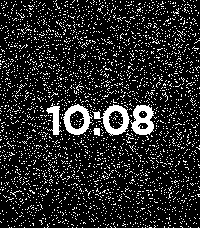
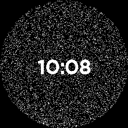
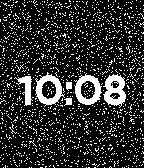
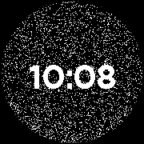
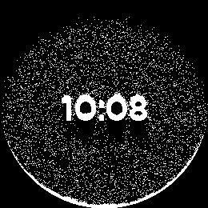
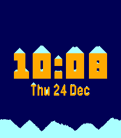
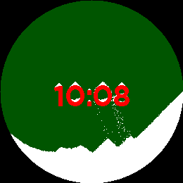

# Snow

A snow-globe watchface for every Pebble, including Pebble Time 2 (emery) and
Pebble Round 2 (gabbro). Snow falls with gravity, piles up on the clock and
along the edge of the glass, slides when you tilt your wrist, and flies back up
when you flick it.

On the Rebble appstore as
[Snow (Updated)](https://apps.repebble.com/snow-updated_bb08f60115414d268f62841a) (v2.0.0).

 
 

<p>
  
  
  
</p>

Based on **Snow Watchface** by Leo Vandriel (2013), whose source carries
"Copyright (c) 2013 Leo Vandriel. All rights reserved." No public licence for
it has been found.

## What changed from the 2013 original

- **It runs on SDK 4.** The original read the screen by casting the graphics
  context to a bitmap, which SDK 3+ does not allow, and stored pixel positions
  in 16 bits (Round 2 has 67,600 pixels). The snow now lives in its own
  occupancy bitmap, and each frame is redrawn from it. The clock text and the
  edge of a round screen are "wall" pixels in that bitmap, so on Round 2 the
  snow piles up along the curved glass.
- **It no longer divides by zero.** When the watch lay flat, the original
  computed `k % 0`. Now a flat watch gets gentle gravity towards the bottom of
  the screen.
- **Landed snow has friction.** In the original, settled flakes kept shuffling
  sideways, so piles flattened like sand, drained off the digits, and never
  came to rest. Landed snow now only slides diagonally downhill, so heaps hold
  a 45° slope and stay on the digits. Falling snow keeps the original flutter.
- **It rests when the snow settles** (the battery saver, on by default). The
  original simulated at 20 fps all day.

## Settings (Clay page on the phone)

| Section | Setting | Default |
|---|---|---|
| Clock | Clock size: Classic (Bitham 42) / Large (Leco 60 on Time 2 & Round 2, Roboto 49 elsewhere) | Classic |
| | Show the date | off |
| Colours | Sky, snow and clock colours (colour watches) | black / white / white |
| | Black snow on white (black-and-white watches) | off |
| Snow | How much snow: Light 6% / Normal 12% / Heavy 20% / Blizzard 30% of the screen | Normal |
| | Snow shows battery level | off |
| | Endless snowfall (always animating) | off |
| | Wind gusts | off |
| | Hourly flurry | off |
| Motion | Tilt moves the snow | on |
| | Flick to stir | on |
| | Flick turns on the light | on |
| | Sweep with your finger (touch watches only) | on |
| Battery | Rest when settled | on |

## Build and test

```sh
pebble build                                  # all 7 platforms -> build/snow.pbw
pebble install --emulator gabbro
SNOW_DEBUG=1 pebble build                     # on-screen readout, see below
SNOW_PRESET=1 pebble build                    # bake in a feature combination
tools/host/run.sh                             # host-side simulation harness
python3 tools/shot.py gabbro out.png          # screenshot via the QEMU monitor
```

- **Debug readout** (`SNOW_DEBUG=1`):
  `u<unstable flakes> <wake source> b<flakes the last minute change moved> w<wind> ON|zz`.
  `zz` means the battery saver is resting. The wake sources are `t` tick,
  `a` tilt, `s` shake, `h` touch, `b` battery, `f` focus, `u` Quick View,
  `m` settings, `g` gust and `i` launch.
- **Presets** (`SNOW_PRESET=n`), because the settings page can't be driven
  from the CLI:
  1. colours, big clock and date
  2. endless snowfall and wind
  3. battery snow, heavy
  4. blizzard

  Drive the battery with `pebble emu-battery --percent N`.
- **Host harness** (`tools/host/`): compiles `sim.c` on the Mac against a
  stub `pebble.h` and runs every feature for thousands of frames on four
  screen shapes, under a hang alarm. After each phase it checks that every
  flake is unique, on the glass and outside the clock text, and it reports how
  long each scenario takes to settle. Run it after any physics change.
- **Gravity in the emulator:** `pebble emu-accel gravity-y` is "watch held
  upright". The default emulator reading is flat, so snow drifts down slowly.

## Known limits

- **Touch sweep** is untested on hardware. The emulator can't inject a drag
  from the CLI, and the harness covers only the logic. Test it by dragging on
  the emulator window or on a real watch.
- **Installing over a running animated face** on a memory-starved Mac can show
  "<app> is not responding". Press Back, then install again. Snow exits
  cleanly when the emulator isn't starved.
- **Battery cost:** with "Rest when settled" on, a full stir settles in about
  25–45 s, and a minute change in about 1.5 s. Turning the whole globe on its
  side takes 1.5–4 minutes, because the entire pile avalanches across the
  screen. Endless snowfall always animates.

## Releasing

v2.0.0 is live on the store as "Snow (Updated)", a listing of its own with a
new UUID (`ed0e6795-…`), separate from the 2013 original's. To ship an update:

1. Bump `version` in `package.json` past 2.0.0. The store rejects a version
   it already holds.
2. Make sure `store/` is current (see Store assets below).
3. Publish from a clean release build:

   ```sh
   pebble build
   pebble publish --non-interactive --no-gif-all-platforms \
     --release-notes "What changed" \
     --screenshots store/*_[1-5]_*.{gif,png}
   ```

The listing already exists, so `pebble publish` takes its existing-app path.
The release goes live immediately, screenshots are added rather than replaced
(remove old ones on the developer dashboard), and `--name`, `--category`,
`--description` and `--icon-*` are ignored, so change those on the dashboard.

## Store assets

`store/` holds the appstore set: five files for each of the seven platforms,
each at the platform's native size.

| File | Shows |
|---|---|
| `<platform>_1_preview.gif` | A flick: the snow swirls up and settles, at real speed |
| `<platform>_2_time.png` | Settled snow at 10:08, default colours |
| `<platform>_3_snowfall.png` | Mid-fall after the flick |
| `<platform>_4_midnight.png` / `_4_inverted.png` (B&W) | Navy, ice and gold, with the big clock and date |
| `<platform>_5_festive.png` / `_5_tilt.png` (B&W) | Green, white and red, heavy snow, watch tilted 25° |
| `icon_80x80.png`, `icon_144x144.png` | `--icon-small` / `--icon-large` |
| `banner_720x320.png` | Store header (optional) |

Filenames start with the platform because `pebble publish` works out the
platform from the text before the first underscore.

To regenerate (about 4 minutes per platform; this runs `pebble kill` between
platforms, so check no other session is using the emulators):

```sh
python3 tools/record_store.py /tmp/snow_rec          # or name platforms to redo
python3 tools/store_assets.py /tmp/snow_rec
pebble build                                         # back to a release build
```

`record_store.py` builds three variants pinned to 10:08 with build flags.
Gravity is held upright (or at 25°) rather than read from the emulator's flat
accelerometer, and the classic variant flicks itself 45 s after launch, so
nothing depends on pypkjs once a variant is installed. `store_assets.py` finds
the flick in each recording automatically, so no frame numbers need picking by
hand.
